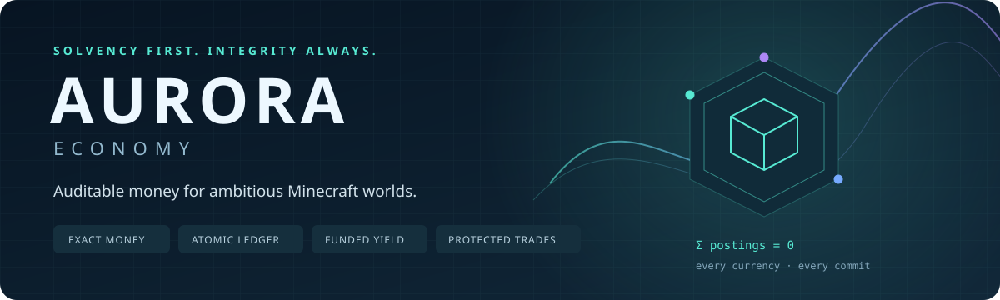

<p align="center"></p>

<p align="center">
  <a href="https://github.com/SHOOP111/aurora-economy/actions/workflows/ci.yml"></a>
  
  
  <a href="LICENSE"></a>
</p>

# Money that can explain itself

**Aurora Economy** is a multi-currency Paper plugin built around an actual financial ledger—not a mutable map of player balances. It combines ordinary server payments with treasury-backed savings, payment escrow, recurring orders and a reserve-backed currency market.

The central design rule: **a feature may move money, but it may not bypass accounting.**

> In-game currencies only. No cryptocurrency, real-money custody, external trading, machine-learning price predictions or magical profit guarantees.

## What is implemented

| System | How it works |
|---|---|
| **Exact multi-currency wallets** | 0–6 decimal places; signed 64-bit minor units; checked arithmetic; per-currency precision pinned to the database. |
| **Double-entry ledger** | Every movement balances independently in each currency. Wallets, treasury, individual savings contracts, individual escrows and market pools are separate accounts. |
| **Durable atomic commits** | SQLite WAL, full synchronization, foreign keys, strict tables for new databases, immutable journal triggers and one serialized writer. Domain state changes commit with their money. |
| **Replay-safe requests** | Actor-scoped keys, intent conflict detection and original durable receipts. `/pay` accepts a reusable request ID; the async API requires one. |
| **Solvency-first savings** | Fixed-term 1–365-day deposits. The full promised yield is reserved from treasury at creation. Maturity never depends on future issuance. |
| **Refundable payment escrow** | Funds and transfer fees are held in isolated custody. Beneficiary acceptance, payer cancellation and offline expiry refunds are atomic. |
| **Recurring payments** | Offline-capable, fee-snapshotted, finite installment orders; atomic execution counters; automatic pause on insufficient funds, spending limits or frozen wallets. No restart catch-up burst. |
| **Reserve-backed exchange** | Treasury-owned constant-product pools; exact big-integer arithmetic; fees retained in reserves; a required minimum output for slippage protection. |
| **Economic policy** | Transfer fees flow to treasury; UTC spending budgets include fees; bounded active contracts; explicit, audited mint/burn controls. |
| **Incident controls** | Audited player wallet freezes. Incoming payments and escrow refunds remain possible; spending and savings claims are blocked. Failed deep audits freeze the entire writer. |
| **Financial observatory** | Read-only inventory dashboard; liquid/locked/custodial portfolio; wallet statements with net deltas; clickable receipts and contracts; wallet leaderboards. |
| **Developer integration** | Bukkit-registered asynchronous `EconomyApi`, plus an optional Vault bridge for the default currency. |
| **Recovery** | Online SQLite snapshots with database SHA-256 and ledger-head manifests; startup audit; versioned schema migrations; downgrade refusal. |
| **GitHub-only verification** | Linux and Windows CI compile Java, run real SQLite and adapter tests, check packaged JAR contents and publish test/coverage artifacts. Tag releases rebuild and test before publishing. |

## Download and install

**Requires Java 21 and Paper 1.21.4.** This release is built against that API. Other Minecraft versions are not promised; Spigot-only servers, Folia and shared multi-server databases are unsupported.

1. Download `aurora-economy-1.0.0.jar` from [Releases](https://github.com/SHOOP111/aurora-economy/releases), or the `libs/` directory of a successful [Actions artifact](https://github.com/SHOOP111/aurora-economy/actions/workflows/ci.yml).
2. Put the **regular JAR**, not `-thin.jar` or `-sources.jar`, in your server's `plugins/` folder.
3. Optionally install Vault before starting the server.
4. Start the server; Aurora creates `plugins/AuroraEconomy/config.yml` and `economy.db`.
5. Read the config, tune starter grants and spending limits, and restart. Do not change a persisted currency's precision or remove it.
6. Use `/eco` for the dashboard, `/eco help` for commands and `/eco admin audit` to inspect integrity.

**Treasury and exchange pools intentionally start empty.** Savings with positive yield need funded treasury reserves, and exchange trades need both pool reserves. There is no background money printer.

### Bootstrap a treasury-owned market

Run as an operator or in the server console (omit `/` in console):

```text
/eco admin mint treasury 250000.00 COIN
/eco admin mint treasury 25000 GEM
/eco admin liquidity COIN GEM 100000.00 10000
/eco admin supply
/eco admin audit
```

This deliberately issues currency, then moves part of treasury into the COIN/GEM pool. Remaining treasury reserves can fund savings interest. The initial inventory ratio implies about 10 COIN per GEM; trades change that ratio, and whole-unit GEM precision causes output rounding.

### Player examples

```text
/pay Alex 125.50 COIN rent-2026-01
/eco bank deposit 250.00 COIN 30
/eco escrow create Alex 80.00 COIN 60
/eco orders create Alex 15.00 COIN 1440 7
/eco exchange quote COIN GEM 100.00
/eco exchange swap COIN GEM 100.00 9
/eco history
```

Replace player names with players who have joined, or use their UUIDs. Use the full contract ID returned by creation commands; clicking one prepares a command without executing it.

## Command reference

`/eco`, `/economy` and `/aurora` are equivalent. `/money`, `/balance` and `/bal` open the wallet summary. `/pay` is the payment alias.

| Command | Permission |
|---|---|
| `/eco`, `/eco menu`, `/eco help`, `/eco wallet`, `/eco history`, `/eco top [currency]` | `aurora.use` |
| `/eco wallet <player>` | `aurora.balance.others` |
| `/pay <player> <amount> [currency] [request-id]` | `aurora.pay` |
| `/eco bank list [page]` | `aurora.bank` |
| `/eco bank deposit <amount> <currency> <days>` | `aurora.bank` |
| `/eco bank claim <id>` | `aurora.bank` |
| `/eco escrow list [page]` | `aurora.escrow` |
| `/eco escrow create <player> <amount> <currency> <minutes>` | `aurora.escrow` |
| `/eco escrow accept <id>` / `cancel <id>` | `aurora.escrow` |
| `/eco orders list [page]` | `aurora.orders` |
| `/eco orders create <player> <amount> <currency> <minutes> <repetitions>` | `aurora.orders` |
| `/eco orders resume <id>` / `cancel <id>` | `aurora.orders` |
| `/eco exchange quote <from> <to> <amount>` | `aurora.exchange` |
| `/eco exchange swap <from> <to> <amount> <min-output>` | `aurora.exchange` |
| `/eco admin mint/burn <player\|treasury> <amount> <currency>` | `aurora.admin` |
| `/eco admin liquidity <currency-a> <currency-b> <amount-a> <amount-b>` | `aurora.admin` |
| `/eco admin freeze <player> <reason>` / `unfreeze <player>` | `aurora.admin` |
| `/eco admin supply`, `audit`, `backup`, `inspect <player>` | `aurora.admin` |

Player feature permissions default to true. Administrative and other-player balance permissions default to operators only. Console can administer the economy but cannot act as a player payer.

## Important semantics

- **Payer pays the transfer fee on top.** A 100.00 COIN payment at 25 bps debits 100.25 COIN. Small fees round upward; rewards and exchange outputs round downward.
- **Escrow is payment custody, not an item marketplace.** The payer can cancel before acceptance. It does not inspect goods, guarantee delivery or adjudicate disputes. [Read the contract model](docs/ECONOMICS.md#payment-escrow).
- **Quotes do not reserve prices.** A swap recalculates from committed reserves and refuses outputs below your stated minimum.
- **Daily limits count actual outgoing spending**, including transfer fees, escrow reservations, swaps and Vault withdrawals. Internal savings movements are not purchases. Refunds do not restore the daily budget.
- **Vault is a trusted legacy bridge.** Its calls are synchronous, its interface uses doubles, and it has no request IDs. External plugin deposits are explicit issuance; withdrawals are explicit burns. Aurora's tax does not automatically apply to a shop's two separate Vault calls. Prefer the async API.
- **Hash chains are tamper-evident, not tamper-proof.** Keep backup manifests off-server to anchor history. An attacker who controls the host and all anchors can rewrite the database and hashes.
- **No local compilation or testing was used to develop this project.** Build and test execution is on GitHub-hosted Actions runners; the Gradle wrapper is provided for reproducibility, not automatically run on your machine.

## Documentation

- [Architecture and transaction invariants](docs/ARCHITECTURE.md)
- [Economic formulas and contract state machines](docs/ECONOMICS.md)
- [Operations, backup and incident recovery](docs/OPERATIONS.md)
- [Async API and Vault integration](docs/API.md)
- [Security model and limitations](SECURITY.md)
- [Testing scope and staging checklist](docs/TESTING.md)
- [Contributing](CONTRIBUTING.md) · [Changelog](CHANGELOG.md) · [MIT license](LICENSE)

## Scope, honestly

This is a substantial, newly built implementation, not a claim of years of production hardening. CI covers financial invariants, persistence, concurrency, adapter permissions and packaging. A real in-game GUI/server acceptance pass and workload-specific profiling are still required before deployment to a valuable production economy. There is no automated live Minecraft-server test in this repository.

There is no network-wide PostgreSQL backend, item escrow, guild bank, loan underwriting, web dashboard, automatic LP redemption or arbitrary legacy-economy importer in v1.0. Those require additional threat models and should not be faked with command stubs.
